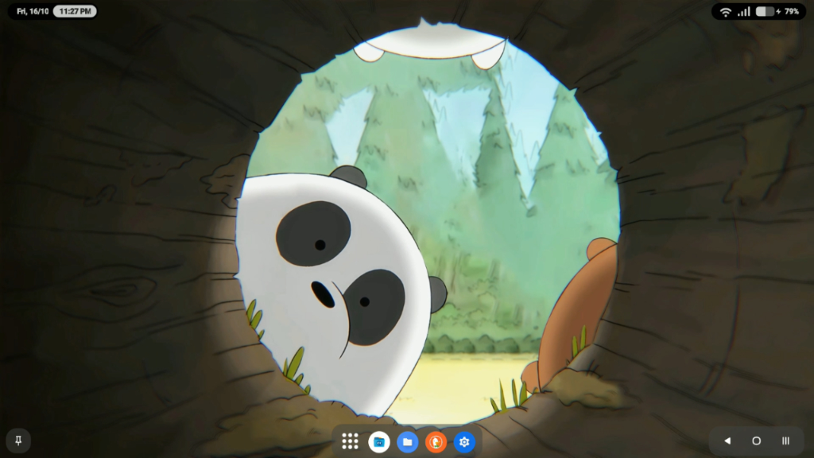
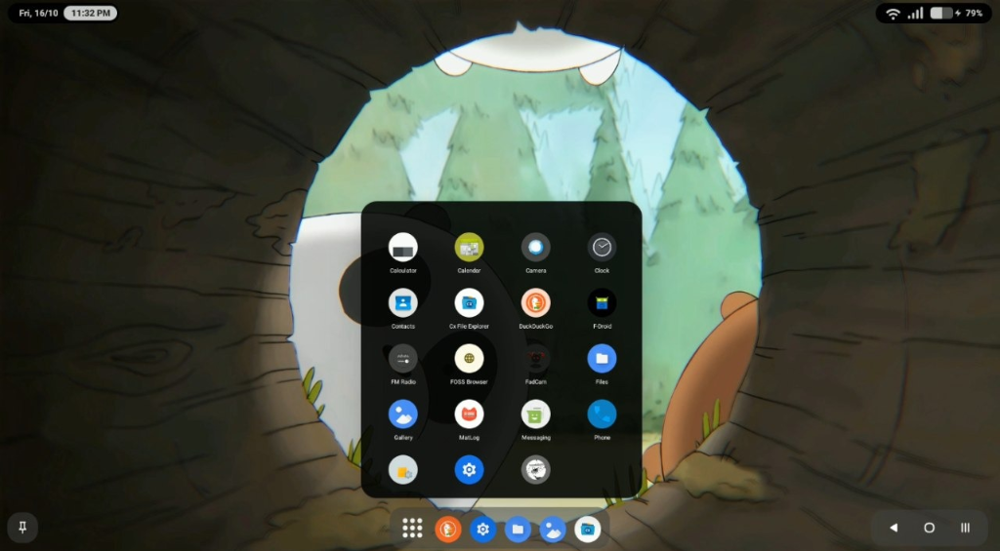
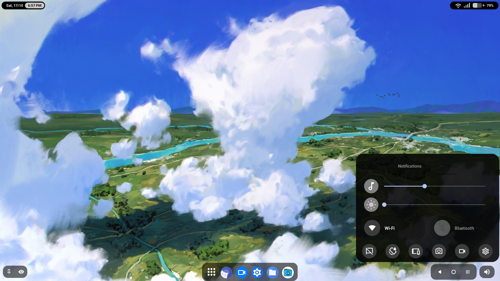

<p align="center">
  
</p>

<h1 align="center">PLate.Dex</h1>

<p align="center">
  A full desktop experience for Android — actively maintained fork of YoukiDex
</p>

<p align="center">
  <a href="https://github.com/Zoro-15/PLate.Dex/releases">
    
  </a>
  <a href="https://github.com/Zoro-15/PLate.Dex/blob/main/LICENSE">
    
  </a>
  <a href="https://github.com/Zoro-15/PLate.Dex/releases/latest">
    
  </a>
  
</p>

---

> 🚀 **About this Fork**: **PLate.Dex** is an actively developed and maintained fork of [YoukiDex](https://github.com/mrYouki/YoukiDex-Android-Desktop) by [mrYouki](https://github.com/mrYouki). Following the discontinuation of the original project, PLate.Dex continues its vision to provide a full desktop environment on Android devices, adding built-in desktop Task View overviews, seamless task management with native RAM clearing, Alt-Tab HUD quick app switching, multi-window fixes, and continuous improvements.

---

## What is this?

**PLate.Dex** turns your phone into something closer to a desktop — a taskbar, an app dock, windows you can resize and move around, hot corners, built-in task overview, the whole thing. It runs as an Accessibility Service overlay, so it doesn't have to become your default launcher (though most people end up setting it as one anyway, just so it loads automatically instead of having to open it every time).

A few features — custom display size, freezing background apps, that kind of thing — need Root or Shizuku. Everything else works out of the box.

---

## About the project

Originally created and built by [mrYouki](https://github.com/mrYouki), the project is now maintained and expanded as **PLate.Dex** by [Zoro-15](https://github.com/Zoro-15).

Updates go out as features and fixes are ready, with an emphasis on rock-solid stability, desktop workflow enhancements (Alt-Tab, Task View, window tiling), and multi-display support.

---

<p align="center">
  <a href="https://discord.gg/mKkaMxd5M2">
    
  </a>
</p>

---

For release notes and version history, check the [GitHub Releases page](https://github.com/Zoro-15/PLate.Dex/releases) — every release has its own detailed changelog.

---

## Features

**Desktop & Multitasking**
- Accessibility-based overlay — works as your launcher or on-demand from a Quick Settings tile / shortcut
- **Built-in Desktop Task View** — full-screen overview of genuinely active apps with keyboard navigation and automated native RAM clearing on "Clear All"
- **Alt-Tab & HUD Switcher** — fast keyboard and shortcut app switching (`Alt+Tab`, `Ctrl+Tab`, `Alt+<` / `Alt+>`)
- Centered floating dock (KDE-style) or classic edge-pinned dock (Windows-style)
- 3 ready-made dock presets (Minimal / Default / Gesture) that set up everything in one tap
- Resizable floating windows for any app, plus real window tiling (maximize, snap left/right/top/bottom)
- Multiple app windows group under one dock icon, the way Windows or macOS does it
- Hot corners (top-right / bottom-right, each mappable to its own action)
- Multi-display support
- Mouse right-click and hardware keyboard shortcuts work the same as long-press/touch
- An inline calculator in the app search — type "12+7", get a tappable "19"

**Power menu**
- Settings, lock, power off, restart
- Restart or fully close just PLate.Dex itself, without touching the rest of the phone
- Switch to another user directly from the same menu

**Apps**
- Full app drawer with search and sorting, plus the option to hide apps
- Deep shortcuts (long-press for quick actions)
- Icon pack support
- Per-app launch mode (windowed or fullscreen), remembered per app
- Optional forced landscape

**Taskbar & tray**
- Running apps, tap to minimize/restore
- Live CPU and RAM usage
- Battery, Wi-Fi, Bluetooth, volume, date
- Notifications, with per-app silencing
- A Quick Settings-style panel with brightness/volume sliders

**Live wallpaper**
- Animated video wallpaper with its own gallery and a built-in editor — crop, pinch/rotate/pan directly with your fingers, brightness/contrast/saturation, background color
- Portrait and landscape get fully separate settings (scale, position, rotation, even audio speed/pitch), so adjusting one never messes up the other
- Rendered natively — OpenGL ES or Vulkan, your choice, picked once during setup
- Desktop grid for icons and widgets, with Nova-style drag-and-drop that pushes things out of the way

**Workshop**
- A built-in browser for finding wallpapers and fonts, with its own ad blocker and automatic font capture — browse Google Fonts and it grabs and installs whatever font file the page loads, no separate download step
- Comes with sources out of the box (MotionBGs, DesktopHut, MoeWalls for wallpapers; Google Fonts, DaFont, Fontesk for fonts) — add your own by URL

**Plugins**
- Installs plugin ZIPs (its own format, or actual Magisk modules) the same way a Magisk-style manager would — install, uninstall, and a running-service toggle per plugin

**Performance tweaks**
- A separate tab for GPU/thermal/FPS tweaks (e.g. "Thermal Killer" and "HardCoreGT") for pushing specific devices further

**Multi-user**
- Add and switch between device users right from the app, either from a quick popup in the dock or a full management screen

**Cast**
- Send the desktop or media playback to a Cast device

**Sound & look**
- Custom sounds for lock/unlock, charging, notifications, etc.
- Material You colors or fully custom dock bubble color, with adjustable opacity, plus a fully transparent dock option
- Custom fonts — pick one file for Arabic and another for Latin text, and the app switches between them automatically
- Text size scaling, per-app or app-wide, plus a custom number badge on any icon

**With Root or Shizuku**
- Custom display size/resolution, disabling heads-up notifications, freezing background apps, uninstalling system apps, soft reboot
- **Auto-grant** — grants itself everything it needs in one shot (over 20 permissions and system settings) instead of asking permission by permission
- A built-in shell terminal

**Self-test tool**
- A QA feature that opens every screen in the app on an isolated virtual display to catch crashes before a release goes out

---

## Under the hood

Mostly Kotlin, with a Rust engine underneath handling the live wallpaper rendering, math-heavy operations, and text parsing. Roughly 80/20 Kotlin to Rust. Everything that touches Android's actual APIs — the services, the UI, the database — stays in Kotlin.

Runs on Android 8.0 and up, built with Gradle and Cargo.

---

## Screenshots

<p align="center">
  
</p>
<p align="center">
  
</p>
<p align="center">
  
</p>

---

## Quick Start

1. Install the APK and open PLate.Dex
2. Grant the permissions it asks for — Accessibility is the primary one, nothing draws without it
3. Then either add the Quick Settings tile and tap it, set PLate.Dex as your launcher, or use the home-screen shortcut it offers on first launch

---

## Optional: Root or Shizuku

A few features need `WRITE_SECURE_SETTINGS`-level access. Three ways to get there:

- **Shizuku** (easiest long-term) — install it, start it once, then grant PLate.Dex permission when it asks.
- **Root** — Magisk or KernelSU, detected automatically, nothing to set up.
- **ADB**, if you'd rather do it manually and don't have either:
  ```bash
  adb shell pm grant com.plate.launcher android.permission.WRITE_SECURE_SETTINGS
  adb shell appops set com.plate.launcher GET_USAGE_STATS allow
  ```

Without any of these, the app still works — you just won't have the handful of features that need system-level access.

---

## Permissions

| Permission | What it's for |
|---|---|
| `SYSTEM_ALERT_WINDOW` | Draw the dock and floating windows over other apps |
| Accessibility Service | The core of how the overlay works |
| `PACKAGE_USAGE_STATS` | Show recent and running apps |
| `WRITE_SECURE_SETTINGS` / `WRITE_SETTINGS` | System-level settings (Root/Shizuku/ADB only) |
| `QUERY_ALL_PACKAGES` | List installed apps |
| Notification Listener | Show and manage notifications from the dock |
| `MANAGE_USERS` | Multi-user switching |
| `MANAGE_EXTERNAL_STORAGE` / media permissions | Wallpapers, Workshop downloads, backup/restore |
| `BLUETOOTH*` | Bluetooth indicator in the tray |
| `KILL_BACKGROUND_PROCESSES` | Process & RAM management for task clearing |
| `CAPTURE_VIDEO_OUTPUT` | Self-test tool's virtual display (Root/Shizuku only) |

---

## Known issues

**RedMagic & ZTE phones don't do floating windows out of the box.** These brands turn Freeform Windows off by default. Fix:
1. Enable Developer Options (tap Build Number 7 times)
2. Turn on **Force activities to be resizable** and **Enable freeform windows**
3. Go to **Settings → Display → Desktop Mode** and enable it
4. Reboot

Not a PLate.Dex bug — that's just how those phones ship.

**Forced landscape doesn't work on some apps.** If an app hardcodes portrait mode, there's no way to override that without root or system-level access — that's an Android limitation, not something fixable from a regular app.

**Desktop widgets are temporarily disabled.** The code's there, but it's switched off while a few crash edge cases get sorted out first.

**The built-in file manager is disabled.** It exists in the code but it's turned off until it's rebuilt properly. Use any regular file manager app in the meantime.

---

## FAQ

**Do I have to set it as my default launcher?**
No, it works either way — but if you don't, you'll need to open it by hand each time instead of it loading on boot. Most people just set it as default.

**The dock disappeared after a reboot.**
Check that Accessibility is still turned on, and that your phone's battery settings aren't killing it in the background — common on MIUI, ColorOS, and similar.

**Is this fully open source?**
Yes. Contributions and bug reports are always welcome.

**Accessibility won't turn on for me on Android 13+.**
That's Android blocking it because the app wasn't installed from the Play Store. One-time fix:
```bash
adb shell appops set com.plate.launcher REQUEST_INSTALL_PACKAGES allow
```
Then go back to Settings → Accessibility and it should work. Installing via `adb install` instead of a regular APK also skips this entirely.

---

## Disclaimer

Independent open-source project. Not affiliated with or endorsed by Samsung (DeX) or any device OEM.

---

## Credits & Acknowledgements

- **[YoukiDex](https://github.com/mrYouki/YoukiDex-Android-Desktop)** by **[mrYouki](https://github.com/mrYouki)** — the foundation and predecessor upon which PLate.Dex was forked and continued.
- **Smart Dock** — the earlier project that inspired the original YoukiDex.
- The open-source Android community for the invaluable tools, libraries, and resources.

---

<p align="center">Maintained by <a href="https://github.com/Zoro-15">Zoro-15</a> • Forked from <a href="https://github.com/mrYouki/YoukiDex-Android-Desktop">YoukiDex</a> by <a href="https://github.com/mrYouki">mrYouki</a></p>